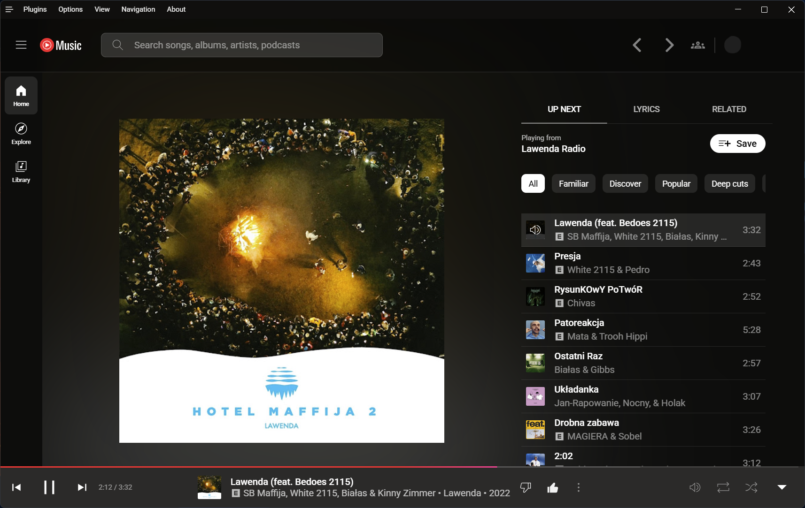
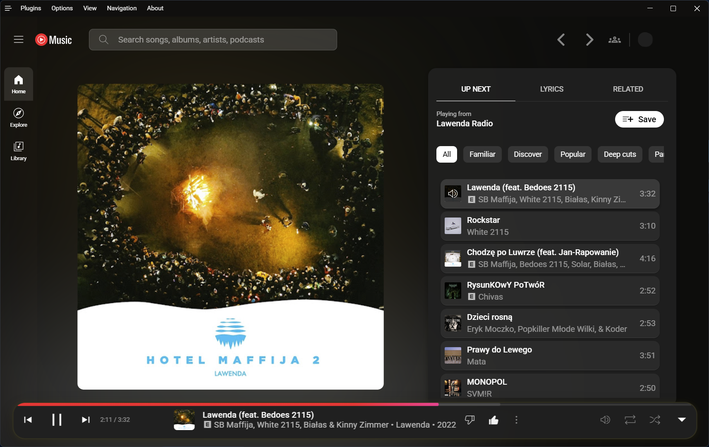

# 🎶 Better YTMusic

 **Better YTMusic** is a project that aims to improve the look and feel of YouTube Music, inspired by Material You.  
This project is currently in **alpha** — please report any bugs or share your ideas for improvements on [Discord](https://discord.gg/2eCpbXadsC)

✅ **Tested and optimized for this desktop version:**  
[YTM by th-ch](https://github.com/th-ch/youtube-music)

---

## 📸 Images

  
  

  <b>Before</b>
  <b>After</b>

---

## ⚙️ Configuration

1. Download the `style.css` file.
2. Go to:  
   `Options → Visual Tweaks → Theme → Import custom CSS file → Select the downloaded file`.
   

I also recommend using my `config.json`

📁 **Place the file in this localization:**

`%appdata%\YouTube Music`
or
`C:\Users\YourUsername\AppData\Roaming\YouTube Music`

Both files can be downloaded from:
`code (more frequent updates)`
or 
`releases tab (bigger updates)`

---

## ⚠️ Known Issues

- All sliders (progress and volume) are rounded based on the current percentage. (and i don't really know how to fix this)

---

## 🚀 Planned Features / To-Do

- Online editor (switch on and off features that u don't like)
- Enchance screen for artists and home screen
- Make the code so that you don't want to kill yourself after seeing

---

## 🙌 Credits

- **Author:** [penetrator](https://github.com/penetratorcwl) (me)
- **Special thanks to:**  
  - AI (mostly github copilot)
